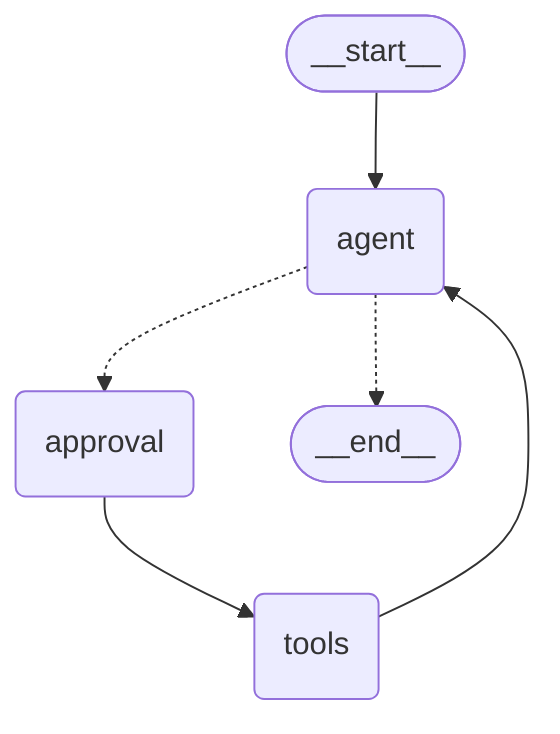

# 第 15 章 · LangGraph 状态机：把一个循环变成一张图

> **这一章要回答的核心问题**：第 14 章那个手写循环已经能跑了，为什么要引入 LangGraph？"图"这个抽象到底换来了什么？State、Node、Edge、Reducer、Checkpointer 这些概念是怎么咬合在一起的？

---

## 15.1 引子：手写循环的四个痛点

第 14 章末尾我们写出了这个循环：

```python
messages = [SystemMessage(...), HumanMessage(content=q)]
for step in range(6):
    ai = await llm.ainvoke(messages)
    messages.append(ai)
    if not ai.tool_calls:
        return ai.content
    for tc in ai.tool_calls:
        obs = await tool.ainvoke(tc["args"])
        messages.append(ToolMessage(content=obs, tool_call_id=tc["id"]))
```

它能在 demo 里跑，但拿到生产环境会立刻撞上四堵墙：

### 痛点 1：状态活在函数局部变量里，服务一重启就蒸发

`messages` 是一个普通的 Python 列表，存在某个请求的内存里。用户聊到一半刷新页面、或者你重启服务发了个版，整个对话历史**全部丢失**。用户只能从头再问一遍。

要解决这个问题，你得自己设计存储结构、序列化消息、按会话 ID 读写、处理并发写入……这些和 Agent 逻辑毫无关系，但工作量巨大。

### 痛点 2：想在中途"暂停等人"，做不到

本项目有个硬需求：**预约是写库操作，必须让用户确认后才能执行**。也就是说，流程要能走到一半**停下来**，把控制权交还给前端，等用户点"确认"，然后从**断点**继续。

手写循环里怎么实现？你只能 `return` 一个中间状态，然后下次请求时重新跑一遍整个循环，用某种方式跳过已经执行过的步骤。极其丑陋，而且状态一致性很难保证。

### 痛点 3：想"看"每一步发生了什么，得手动打日志

线上出问题时，你想知道：这一轮模型收到了什么、返回了什么、调了哪个工具、工具返回了什么、耗时多少、花了多少 token。手写循环里你得在每个环节手动插入日志，还得自己保证日志和状态同步。

### 痛点 4：流程一复杂，代码就变成一坨 if-else

加个"写库前审批"，循环里多一层判断；加个"检索失败降级"，又多一层；再加个"多轮追问澄清"……很快那个 `for` 循环就变成了一百行嵌套的意大利面。

**LangGraph 这四个问题全解了**，而且解法非常优雅。它的核心思路是：

> **把 Agent 的执行流程抽象成一张有向图（StateGraph），把"状态"从函数局部变量提升为图的一等公民，由框架负责状态的流转、持久化、中断与恢复。**

你不再写"循环"，你**声明图的结构**，框架帮你执行。

---

## 15.2 LangGraph 的四个核心概念

LangGraph 的全部抽象就四个词，理解透这四个词，你就理解了 90%：

| 概念 | 是什么 | 类比 |
|---|---|---|
| **State** | 在节点之间流转的共享数据 | 工厂流水线上的"工件" |
| **Node** | 一个处理步骤，接收 State、返回 State 的部分更新 | 流水线上的"工位" |
| **Edge** | 节点之间的连线，决定下一步去哪 | 传送带的走向 |
| **Checkpointer** | 在每个节点执行后把 State 存起来的机制 | 流水线的"工位快照" |

再加上一个第五概念，它是 LangGraph 最精妙的设计：

| **Reducer** | 定义"节点返回的更新如何合并进 State"的规则 | 工件怎么被修改：追加还是替换 |

---

## 15.3 State：一切的基础

### 15.3.1 最小骨架：定义一个 State

```python
from typing import Annotated, TypedDict
from langchain_core.messages import AnyMessage
from langgraph.graph.message import add_messages


class AgentState(TypedDict, total=False):
    messages: Annotated[list[AnyMessage], add_messages]
    approval: dict | None
```

这就是本项目 `agent_service.py:45-53` 的完整定义。短短几行，但每一行都有讲究。

### 15.3.2 为什么用 TypedDict 而不是 dataclass / Pydantic？

因为 LangGraph 需要**在运行时动态读写 State 的字段**，而且希望保持轻量。`TypedDict` 只是一个类型注解，运行时就是普通 `dict`，零开销：

```python
state["messages"]        # 直接读
state.get("approval")    # 带默认值读
```

如果用 Pydantic `BaseModel`，每次节点执行都要做一次校验——在 Agent 循环里这是几十次/秒的操作，纯浪费。而 `TypedDict` 只在类型检查阶段生效（mypy / IDE），运行时零成本。

> `total=False` 的意思是：所有字段都是可选的。因为节点返回的只是**部分更新**，比如 `agent_node` 只返回 `{"messages": [...]}`，`approval` 字段根本不会出现。如果不加 `total=False`，类型检查器会抱怨"缺少字段 approval"。

### 15.3.3 `Annotated[..., add_messages]` —— 这一章最重要的知识点

这是 LangGraph 新手最容易懵的一行，也是面试最能拉开差距的一行。

```python
messages: Annotated[list[AnyMessage], add_messages]
```

拆开看：

- `list[AnyMessage]`：字段的类型（给类型检查器看的）
- `add_messages`：这个字段的 **Reducer**（给 LangGraph 运行时看的）
- `Annotated[X, Y]`：Python 标准语法，把额外元数据 `Y` 挂在类型 `X` 上

**Reducer 是什么？** 它回答一个问题：**当节点返回 `{"messages": [new_msg]}` 时，这个 `new_msg` 应该怎么合并进已有的 `state["messages"]`？**

两种可能：

| 策略 | 结果 | 说明 |
|---|---|---|
| **替换（默认）** | `state["messages"] = [new_msg]` | 旧消息全部丢失 |
| **追加（add_messages）** | `state["messages"] = old + [new_msg]` | 历史累积 |

对于对话场景，显然是追加。所以：

```python
from langgraph.graph.message import add_messages
```

**这就是本项目里所有节点都"只返回增量"却能累积成完整对话的原因**：

```python
async def agent_node(state: AgentState) -> dict:
    response = await llm.ainvoke(...)
    return {"messages": [response]}   # ← 只返回一个元素
```

执行完，`state["messages"]` 里是 `[...历史..., response]`。

### 15.3.4 `add_messages` 不只是"列表相加"

如果 `add_messages` 只是 `a + b`，那你自己写一行 `state["messages"] += new` 也行。但它多做了一件关键的事：**按消息 ID 去重与更新**。

看这个例子：

```python
from langchain_core.messages import AIMessage
from langgraph.graph.message import add_messages

existing = [AIMessage(content="A", id="msg-1")]
new      = [AIMessage(content="A-modified", id="msg-1")]

add_messages(existing, new)
# → [AIMessage(content="A-modified", id="msg-1")]
#   不是两条！同 id 被覆盖了
```

这个特性在**流式输出**场景下至关重要。因为流式时，同一条 AI 消息会分很多 chunk 到达，每个 chunk 都是同一个 `id`、内容逐步变长。如果没有 id 去重，你的 messages 列表里会塞进几十条重复消息。有了它，框架自动合并成一条完整消息。

> ⚠️ **坑 1（真实）**：如果你自己构造消息时**不设 id**，LangChain 会自动生成 UUID，每次都一样吗？不一样——每次 `AIMessage(content=...)` 都会生成新 UUID。所以"去重"只在**同一个消息对象被反复返回**时才生效（流式场景框架内部保证）。手工构造历史消息时要意识到这一点。

### 15.3.5 自定义 Reducer：不止追加

Reducer 是任意函数 `(old, new) -> merged`。你可以写自己的：

```python
def keep_last(old, new):
    """保留最新值（覆盖语义）。"""
    return new if new is not None else old

def merge_dict(old: dict, new: dict) -> dict:
    """字典浅合并，而不是整体替换。"""
    return {**(old or {}), **(new or {})}

def cap_history(old: list, new: list, cap: int = 20):
    """追加但限制最大长度——自动丢弃最老的。"""
    merged = (old or []) + (new or [])
    return merged[-cap:]
```

本项目里 `approval` 字段**没有指定 Reducer**：

```python
approval: dict | None
```

这意味着默认行为：**覆盖**。每次 `approval_node` 返回 `{"approval": decision}`，就直接覆盖掉上一次的决策。这正是我们想要的——**只关心最近一次审批结果**，不需要历史累积。

> **面试加分词**："State 的每个字段都要显式想清楚它的合并语义：对话消息要追加（add_messages），审批结果要覆盖（默认），计数器要累加（operator.add），配置要浅合并。这个决策如果一开始没想清楚，后面会出现很诡异的 bug。"

---

## 15.4 Node：一个节点就是一个函数

### 15.4.1 节点的契约

节点的签名极其简单：

```python
def node(state: AgentState) -> dict:      # 同步
async def node(state: AgentState) -> dict:  # 异步
```

契约只有三条：

1. **输入**：完整的 State（只读，不要修改它）
2. **输出**：一个 dict，只含**要更新的字段**
3. **不要 raise**（除非你想中断整个流程）

本项目三个节点：

```python
async def agent_node(state: AgentState) -> dict:      # agent_service.py:264
async def approval_node(state: AgentState) -> dict:   # agent_service.py:272
async def tool_node(state: AgentState) -> dict:       # agent_service.py:289
```

### 15.4.2 最小骨架：一个能跑的三节点图

下面是一个**完全可运行**的例子（不需要 API Key，用假 LLM）：

```python
"""
minimal_graph.py —— LangGraph 最小骨架
运行：pip install langgraph langchain-core && python minimal_graph.py
"""
import asyncio
from typing import Annotated, TypedDict

from langchain_core.messages import AIMessage, AnyMessage, HumanMessage
from langgraph.graph import END, START, StateGraph
from langgraph.graph.message import add_messages


# ── 1. State ──────────────────────────────────────────────
class State(TypedDict, total=False):
    messages: Annotated[list[AnyMessage], add_messages]
    step_count: int          # 无 Reducer → 覆盖语义


# ── 2. 节点 ───────────────────────────────────────────────
async def echo_node(state: State) -> dict:
    """模拟"模型节点"：把最后一条用户消息变成一条 AI 消息。"""
    last_user = state["messages"][-1].content
    n = (state.get("step_count") or 0) + 1
    print(f"  [echo_node] 第 {n} 次进入，收到：{last_user}")
    return {
        "messages": [AIMessage(content=f"回复#{n}：{last_user}")],
        "step_count": n,
    }


def should_continue(state: State) -> str:
    """条件边：没到 3 次就继续，到了就结束。"""
    n = state.get("step_count") or 0
    print(f"  [route] step_count={n} → {'end' if n >= 3 else 'loop'}")
    return "end" if n >= 3 else "loop"


async def bump_node(state: State) -> dict:
    """模拟"工具节点"：追加一条用户消息，制造循环。"""
    print("  [bump_node] 追加一条追问")
    return {"messages": [HumanMessage(content="再来一轮")]}


# ── 3. 建图 ───────────────────────────────────────────────
def build():
    g = StateGraph(State)
    g.add_node("echo", echo_node)
    g.add_node("bump", bump_node)

    g.add_edge(START, "echo")                              # 入口
    g.add_conditional_edges(                               # 条件分支
        "echo",
        should_continue,
        {"end": END, "loop": "bump"},                      # 返回值 → 目标节点
    )
    g.add_edge("bump", "echo")                             # ★ 回到 echo，形成循环
    return g.compile()


async def main():
    print("=== 开始执行图 ===")
    result = await build().ainvoke({"messages": [HumanMessage(content="你好")]})
    print("\n=== 最终 state ===")
    for i, m in enumerate(result["messages"]):
        print(f"  [{i}] {type(m).__name__}: {m.content}")
    print(f"  step_count = {result['step_count']}")


if __name__ == "__main__":
    asyncio.run(main())
```

**输出：**

```
=== 开始执行图 ===
  [echo_node] 第 1 次进入，收到：你好
  [route] step_count=1 → loop
  [bump_node] 追加一条追问
  [echo_node] 第 2 次进入，收到：再来一轮
  [route] step_count=2 → loop
  [bump_node] 追加一条追问
  [echo_node] 第 3 次进入，收到：再来一轮
  [route] step_count=3 → end

=== 最终 state ===
  [0] HumanMessage: 你好
  [1] AIMessage: 回复#1：你好
  [2] HumanMessage: 再来一轮
  [3] AIMessage: 回复#2：再来一轮
  [4] HumanMessage: 再来一轮
  [5] AIMessage: 回复#3：再来一轮
  step_count = 3
```

**从这个输出里确认三件事**：

1. `messages` 是**追加**的（6 条），而 `step_count` 是**覆盖**的（最终 3）——Reducer 差异一目了然。
2. 循环是靠 `add_edge("bump", "echo")` 实现的，不是靠 Python 的 `for`。
3. 出口是靠条件边的返回值 `END` 实现的，不是靠 `break`。

### 15.4.3 节点里的三条铁律

**铁律 1：不要修改传入的 state**

```python
# ❌ 错误
async def bad_node(state: State) -> dict:
    state["messages"].append(new_msg)   # 直接改了共享对象
    return {}

# ✅ 正确
async def good_node(state: State) -> dict:
    return {"messages": [new_msg]}      # 只返回增量，让 Reducer 合并
```

为什么？因为 LangGraph 需要**对比执行前后的 state 来决定要不要持久化**。你直接改了对象，框架可能检测不到变化，导致 checkpointer 不写入。

**铁律 2：只返回你真正要改的字段**

```python
return {"messages": [response]}     # ✅ 只返回 messages
return {"messages": [...], "approval": None}  # ❌ 不必要地清空 approval
```

本项目 `approval_node` 里有个细节：

```python
if not write_calls:
    return {"approval": None}
```

没有写库工具时**显式返回 `{"approval": None}`**，而不是返回 `{}`。这是为了**主动清空上一次的审批决策**，避免残留的 `approved=True` 影响后续。这是一个很容易漏的防御点。

**铁律 3：节点要幂等（尽可能）**

因为 LangGraph 有重试和从断点恢复的机制，同一个节点可能被意外执行两次。节点里如果做了不可重试的副作用（比如发短信、扣款），会出大问题。本项目的对策是把写库动作单独隔离到 `create_lab_reservation` 工具，并在前面加 `interrupt`。

---

## 15.5 Edge：图的走向

### 15.5.1 三种边

```python
# ① 普通边：固定的下一步
graph.add_edge(START, "agent")
graph.add_edge("approval", "tools")
graph.add_edge("tools", "agent")

# ② 条件边：运行时决定下一步
graph.add_conditional_edges(
    "agent",              # 从哪个节点出发
    _route_after_agent,   # 路由函数 (state) -> str
    {"approval": "approval", "end": END},  # 返回值 → 目标映射
)

# ③ 入口边：从 START 开始
graph.add_edge(START, "agent")
```

### 15.5.2 路由函数的约定

```python
def _route_after_agent(state: AgentState) -> str:
    last = state["messages"][-1]
    if getattr(last, "tool_calls", None):
        return "approval"
    return "end"
```

约定：

- 接收完整 state
- 返回一个**字符串**
- 这个字符串必须在映射字典里有对应项，否则报 `ValueError`

**注意**：路由函数**不做任何计算**，只做判断。它是纯函数，不应该有副作用。所有业务逻辑应该在节点里完成。

### 15.5.3 条件边的第三个参数为什么是字典而不是直接写节点？

你可能会问，为什么不写成：

```python
graph.add_conditional_edges("agent", _route_after_agent)  # 直接返回节点名?
```

因为**解耦**。用映射字典，你的路由函数可以返回业务语义的字符串（`"approval"`、`"end"`、`"need_clarification"`），然后在建图时决定它们映射到哪个节点。这样：

- 路由函数可测试（不用 mock 图）
- 重构图结构时不用改路由逻辑
- 同一个路由函数可以在不同图里复用，映射到不同目标

### 15.5.4 用可视化确认图结构

任何编译后的图都能导出 Mermaid：

```python
print(graph.get_graph().draw_mermaid())
```

本项目的图会输出类似：



> 调试技巧：图的行为不符合预期时，**先打印图结构确认连线和自己想的一样**。有一半的 bug 是连线连错了。

---

## 15.6 超步（Superstep）：理解执行粒度

这是 LangGraph 里一个反直觉但必须懂的概念，直接决定 `recursion_limit` 怎么设。

### 15.6.1 什么是超步

LangGraph 的执行不是"一个节点跑完立刻跑下一个"，而是**分批（batch）**执行：

```
第 1 个超步：[agent]                 ← 只有 agent 可执行
第 2 个超步：[approval]              ← agent 的输出决定了下一步
第 3 个超步：[tools]
第 4 个超步：[agent]                 ← 回到 agent
第 5 个超步：[approval]
第 6 个超步：[tools]
第 7 个超步：[agent]                 ← 这次没有 tool_calls → END
```

**每个超步执行"当前所有可执行且并行的节点"**，然后统一提交 state 更新，再决定下一批。

### 15.6.2 为什么要有超步？为了并行

超步机制让 LangGraph 能**自动并行执行没有依赖关系的节点**。比如：

```python
graph.add_edge(START, "fetch_user")
graph.add_edge(START, "fetch_labs")
graph.add_edge("fetch_user", "combine")
graph.add_edge("fetch_labs", "combine")
```

执行：
```
超步1: [fetch_user, fetch_labs]   ← 并行！
超步2: [combine]
```

如果节点是 `async def`，它们会在同一个超步里被 `asyncio.gather` 并发执行。

### 15.6.3 这对 recursion_limit 意味着什么

回到本项目的 `recursion_limit=10`：

```python
{"configurable": {"thread_id": thread_id}, "recursion_limit": 10}
```

一轮完整的"思考-行动-观察"消耗的超步：

| 步骤 | 超步数 |
|---|---|
| agent（决定调工具） | 1 |
| approval（interrupt） | 1 |
| tools（执行） | 1 |
| agent（看到结果，给出答案） | 1 |
| **合计** | **4** |

所以 `recursion_limit=10` **最多支持约 2 轮完整工具循环**（2×4 = 8，加上初始和收尾 = 10）。

> ⚠️ **坑 2（真实且高频）**：很多人以为 `recursion_limit=10` 是"10 轮对话"，实际是"10 个超步"。本项目因为多了 approval 节点，实际只能撑 2-3 轮工具循环。如果后续要支持更复杂的多步任务，这个值要调大，或者去掉 approval 节点的无条件连线（只在有写库工具时才进 approval）。

### 15.6.4 一个真实的设计权衡

`graph.add_edge("approval", "tools")` 是**无条件边**——即使 `approval_node` 判断"不需要审批"（`return {"approval": None}`），也一定会多走一个超步。

**这是浪费吗？** 是的，一次查询类请求（只调 `search_lab_docs`）会白白多消耗一个超步。

**为什么还这么做？** 因为简单。要优化，可以改成条件边：

```python
graph.add_conditional_edges(
    "approval",
    lambda s: "tools" if s.get("approval") is not None or 有写库意图 else "end",
    ...
)
```

但这会让路由逻辑变复杂。**这是一个典型的"先正确、后优化"决策**，面试时讲出来说明你有工程判断力。

---

## 15.7 Checkpointer：让图"记住"自己

这是 LangGraph 最有价值的能力，也是第 17 章的主题。这里先建立基础认知。

### 15.7.1 它做了什么

```python
graph.compile(checkpointer=checkpointer)
```

加上这一行之后，LangGraph 会在**每个超步结束后**，把当前 State 序列化存到后端，并关联一个 `thread_id`。

```
调用 1: ainvoke({"messages": [HumanMessage("你好")]}, {"thread_id": "t-1"})
        → 存下 checkpoint-1

调用 2: ainvoke({"messages": [HumanMessage("再问一个")]}, {"thread_id": "t-1"})
        → 自动加载 checkpoint-1，把新消息追加进去
        → 存下 checkpoint-2
```

**关键**：第二次调用时，你**只传新消息**，历史由框架自动补上。

### 15.7.2 这个设计如何影响 API 层

看本项目的 `_build_input_messages`（`agent_service.py:345-353`）：

```python
def _build_input_messages(data: ChatRequest) -> list:
    """只取本轮新增的用户消息；历史由 checkpointer 负责，前端不再回传。"""
    messages = []
    for message in data.messages or []:
        if message.role == "user" and message.content.strip():
            messages.append(HumanMessage(content=message.content.strip()))
    if not messages:
        raise BusinessException(message="请输入您要对话的内容")
    return messages
```

**注意这里的取舍**：前端其实把整个 `messages` 数组都传过来了（因为要在页面上显示对话），但后端**只取最后的用户消息**，历史完全交给 checkpointer。

为什么这么做？三个理由：

1. **单一数据源（Single Source of Truth）**：历史只有一个地方存（checkpoint 库），不会出现"前端传的和后端存的不一致"。
2. **省带宽**：长对话时前端不用每轮回传几十 KB 的历史。
3. **防篡改**：用户不能通过篡改前端传的历史来伪造上下文。

> ⚠️ **坑 3（真实）**：这里有个隐藏的一致性问题——**前端显示的对话和后端 checkpointer 里的对话可能不同步**。比如用户开两个标签页，A 页面聊了几轮，B 页面的显示就落后了。本项目没解决这个问题（单用户场景够用），但如果要做，需要前端也按 `thread_id` 从后端拉历史。这是一个可以写进简历的优化点。

### 15.7.3 双后端抽象（本项目实现）

`agent_service.py:110-135`：

```python
async def get_checkpointer():
    """懒加载全局 checkpointer。
    - 配置了 CHECKPOINT_DATABASE_URL → AsyncPostgresSaver（会话状态与业务库同源）。
    - 否则 → AsyncSqliteSaver（本地文件，零配置）。
    """
    global _checkpointer, _checkpointer_cm
    if _checkpointer is not None:
        return _checkpointer

    if settings.CHECKPOINT_DATABASE_URL:
        from langgraph.checkpoint.postgres.aio import AsyncPostgresSaver
        _checkpointer_cm = AsyncPostgresSaver.from_conn_string(
            settings.CHECKPOINT_DATABASE_URL
        )
        _checkpointer = await _checkpointer_cm.__aenter__()
        await _checkpointer.setup()
        logger.info("checkpointer 已就绪：PostgreSQL")
    else:
        path = Path(settings.CHECKPOINT_DB_PATH)
        path.parent.mkdir(parents=True, exist_ok=True)
        _checkpointer_cm = AsyncSqliteSaver.from_conn_string(str(path))
        _checkpointer = await _checkpointer_cm.__aenter__()
        logger.info("checkpointer 已就绪：SQLite（%s）", path)
    return _checkpointer
```

三个设计点，面试值得讲：

**① 全局单例 + 懒加载**

checkpointer 是**进程级**的，不是每个请求创建一个。因为它是连接池，频繁创建销毁会耗尽连接。`global` + `if _checkpointer is not None: return` 实现单例。

**② 保存Context Manager 对象本身**

```python
_checkpointer_cm = AsyncPostgresSaver.from_conn_string(...)
_checkpointer = await _checkpointer_cm.__aenter__()
```

注意存了**两个**全局变量：`_checkpointer_cm`（上下文管理器）和 `_checkpointer`（真正的 saver）。因为 `__aenter__()` 返回的对象和 `from_conn_string()` 返回的不是同一个，而退出时需要调用 `__aexit__()` 释放连接。

看 `close_checkpointer`（`agent_service.py:138-144`）：

```python
async def close_checkpointer() -> None:
    """应用关闭时释放 checkpointer 连接。"""
    global _checkpointer, _checkpointer_cm
    if _checkpointer_cm is not None:
        await _checkpointer_cm.__aexit__(None, None, None)
        _checkpointer_cm = None
        _checkpointer = None
```

这在 FastAPI 的 `lifespan` 里被调用（shutdown 阶段），保证优雅关闭。

> ⚠️ **坑 4（真实）**：早期版本的 langgraph 里 `AsyncSqliteSaver` 的 `__aenter__` 被移除过（抛 `NotImplementedError`）。这类库 API 变动在 LangChain 生态里很常见，**所以版本锁定很重要**。本项目的 `requirements.txt` 锁定了具体版本，就是这个原因。

**③ 为什么要支持 PG？**

SQLite 够用吗？开发环境够，生产不够：

| 维度 | SQLite | PostgreSQL |
|---|---|---|
| 多实例部署 | ❌ 文件锁，多进程会冲突 | ✅ 共享存储 |
| 并发写 | ❌ 写锁串行 | ✅ MVCC |
| 容量 | 单机文件 | 独立服务 |
| 备份 | 拷贝文件 | 标准数据库备份 |

**"多实例安全"是核心理由**：生产环境你的 FastAPI 通常会跑多个 worker / 多个容器，SQLite 文件锁会让状态错乱。

---

## 15.8 项目代码定位：完整走一遍图的生命周期

### 15.8.1 建图（`agent_service.py:317-329`）

```python
graph = StateGraph(AgentState)
graph.add_node("agent", agent_node)
graph.add_node("approval", approval_node)
graph.add_node("tools", tool_node)
graph.add_edge(START, "agent")
graph.add_conditional_edges(
    "agent", _route_after_agent, {"approval": "approval", "end": END}
)
graph.add_edge("approval", "tools")
graph.add_edge("tools", "agent")

checkpointer = await get_checkpointer()
return graph.compile(checkpointer=checkpointer)
```

**注意 `build_agent` 是 async 的，而且每次请求都调用**：

```python
async def build_agent(db: Session, current_user: User, include_uploaded: bool = True):
```

每次 `run_agent` / `resume_agent` 都会重建图。为什么？

因为**工具是绑定了用户身份和数据库会话的**（第 20 章会讲闭包注入）：

```python
tools = await agent_tools.build_tools(db, current_user, include_uploaded=include_uploaded)
```

不同用户能用的工具不同（比如只有管理员能上传文档），所以图必须按用户构建。

**代价**：每次请求都要重建图对象（毫秒级，可接受），但 checkpointer 是复用的。这个"重建图 + 复用 checkpointer"的组合是标准做法。

### 15.8.2 执行（`agent_service.py:371-387`）

```python
async def run_agent(db, current_user, data: ChatRequest, thread_id: str) -> str:
    """非流式执行 Agent。遇到写库工具会抛 ApprovalRequired。"""
    agent = await build_agent(db, current_user, data.include_uploaded)
    inputs = {"messages": _build_input_messages(data)}
    try:
        result = await agent.ainvoke(inputs, _make_config(thread_id))
    except BusinessException:
        raise
    except Exception:
        raise BusinessException(message="大模型调用失败，请稍后重试")

    interrupts = result.get("__interrupt__")
    if interrupts:
        raise ApprovalRequired(thread_id=thread_id, payload=_interrupt_payload(interrupts))
    return _last_ai_text(result.get("messages") or [])
```

四个要点：

**① `except BusinessException: raise` 在前**

```python
except BusinessException:
    raise                      # 业务异常原样抛出，保留错误信息
except Exception:
    raise BusinessException(message="大模型调用失败，请稍后重试")   # 其他异常统一包装
```

顺序不能反！因为 `BusinessException` 是 `Exception` 的子类，如果顺序反了，业务异常会被"大模型调用失败"这个泛化信息吞掉，用户就看不到"未配置 API Key"这样的准确提示了。

**② `__interrupt__` 是特殊的 state 字段**

```python
interrupts = result.get("__interrupt__")
```

当图里执行了 `interrupt()`，LangGraph 不会抛异常，而是**暂停执行并把中断信息放进 result 的 `__interrupt__` 字段**。你需要主动检查这个字段。这是 LangGraph interrupt 机制的核心约定（第 18 章详述）。

**③ 转成业务异常抛给 API 层**

```python
raise ApprovalRequired(thread_id=thread_id, payload=_interrupt_payload(interrupts))
```

`ApprovalRequired` 是一个自定义异常（`agent_service.py:56-62`），携带 `thread_id` 和 `payload`。API 层捕获后转成 HTTP 响应，让前端弹出确认框。**这是"服务层不感知 HTTP，用异常向上传递信号"的典型分层实践**。

**④ `_last_ai_text` 从 state 里提取答案**

```python
def _last_ai_text(messages: list) -> str:
    """从 Agent 结果里取最后一条有内容的 AI 消息。"""
    for message in reversed(messages):
        if isinstance(message, AIMessage):
            content = message.content
            if isinstance(content, list):
                content = "".join(
                    part.get("text", "") if isinstance(part, dict) else str(part)
                    for part in content
                )
            if str(content or "").strip():
                return str(content).strip()
    raise BusinessException(message="大模型没有任何返回内容")
```

为什么要**倒序找最后一条有内容的**？因为多轮工具调用会产生多条 `AIMessage`，其中**中间的那些可能 content 为空**（只有 tool_calls）。比如：

```
[0] HumanMessage: "预约显微镜实验室"
[1] AIMessage(content="", tool_calls=[...])     ← 空内容
[2] ToolMessage: {...}
[3] AIMessage(content="已为您预约成功...")       ← 我们要的
```

顺序遍历会拿到 `[1]`（空），倒序 + 判空才能拿到 `[3]`。

**`content` 可能是 list 的处理**：某些模型（如 Claude）返回的 content 是结构化列表 `[{"type": "text", "text": "..."}]`，需要拼接。这是跨模型兼容的防御写法。

### 15.8.3 配置（`agent_service.py:332-333`）

```python
def _make_config(thread_id: str) -> dict:
    return {"configurable": {"thread_id": thread_id}, "recursion_limit": 10}
```

`configurable` 是 LangGraph 的保留 key，里面的 `thread_id` 决定 checkpointer 用哪个"线程"。`recursion_limit` 是平级的配置项。

> **thread_id 从哪来？** 前端生成并维护（通常是 UUID），每次请求带上。后端用它隔离不同会话。详见第 17 章。

---

## 15.9 流式执行：`astream` 与事件类型

本项目支持流式输出，用的是 `astream_events`（第 31 章详述）。这里先建立和图的对应关系。

```python
async for event in agent.astream_events(inputs, _make_config(thread_id), version="v2"):
    kind = event["event"]
    if kind == "on_chat_model_stream":
        # 模型吐出的每个 token
    elif kind == "on_tool_start":
        # 工具开始执行
    elif kind == "on_tool_end":
        # 工具执行结束
```

**为什么用 `astream_events` 而不是 `astream`？**

| API | 返回粒度 | 用途 |
|---|---|---|
| `astream` | 每个节点执行完的状态更新 | 粗粒度，适合后端内部 |
| `astream_events` (v2) | 细粒度事件流（token、工具起止、链起止） | 前端打字机效果 |

本项目需要"模型一个字一个字往外吐"的效果，所以必须用 `astream_events`。

> ⚠️ **坑 5（真实）**：`astream_events` 必须显式传 `version="v2"`。v1 的事件格式不稳定且已废弃，不传会拿到不一致的结构。

---

## 15.10 为什么选 LangGraph 而不是别的？

面试时很可能会被问"为什么用 LangGraph / 和其他框架比过吗"。你需要一个有理有据的选型说明。

| 方案 | 特点 | 为什么本项目没选 |
|---|---|---|
| **手写循环** | 完全可控、零依赖 | 状态持久化、中断恢复、可观测性全要自己造（15.1 的四个痛点） |
| **LangChain AgentExecutor** | 早期标准方案 | 已被官方标记为 legacy，循环黑盒、难以插入自定义节点（如审批），不支持 interrupt |
| **LangGraph** | 图抽象 + 状态持久化 + interrupt | ✅ 选中 |
| **AutoGen** | 多 Agent 对话编排见长 | 我们不是多 Agent 对话场景，且状态管理不如 LangGraph 清晰 |
| **CrewAI** | 角色扮演式多 Agent | 抽象层次太高，难以精确控制单个步骤，不适合需要审批拦截的场景 |
| **Dify / Coze** | 低代码平台 | 需要代码级控制和自定义工具，平台反而受限 |

**选中 LangGraph 的三个决定性理由**（面试照这个说）：

1. **interrupt 机制**：我们需要在写库前暂停等人工确认，LangGraph 的 `interrupt()` + `Command(resume=...)` 是唯一把这个场景做成一等公民的方案。
2. **checkpointer**：状态持久化和从断点恢复开箱即用，且支持 PG 生产后端。
3. **可控性**：图结构显式声明，每个节点都是普通 Python 函数，可以精确插入自定义逻辑（审批、裁剪、错误回填），而 AgentExecutor 那种黑盒循环做不到。

同时要诚实说明代价：

> "LangGraph 的学习曲线比 AgentExecutor 陡，State/Reducer/Checkpointer 这些概念需要时间理解；而且 LangChain 生态版本迭代快，API 时有 breaking change，我们锁定了版本。"

---

## 15.11 面试问答

### Q1：LangGraph 的核心概念有哪些？

**答**：四个——State、Node、Edge、Checkpointer，加上 Reducer 这个关键的合并规则。

- **State** 是在节点间流转的共享数据，本项目用 `TypedDict` 定义，有 `messages` 和 `approval` 两个字段。
- **Node** 是处理函数，接收 State、返回部分更新。本项目有 agent（调模型）、approval（审批拦截）、tools（执行工具）三个。
- **Edge** 决定走向，分普通边和条件边。本项目 `agent` 后面是条件边，根据有没有 tool_calls 决定进审批还是结束。
- **Checkpointer** 在每个超步后持久化 State，支持 SQLite/PG 双后端。
- **Reducer** 定义字段的合并语义：`messages` 用 `add_messages` 追加，`approval` 用默认的覆盖。

### Q2：`Annotated[list[AnyMessage], add_messages]` 是什么意思？

**答**：这是给 `messages` 字段指定 Reducer。`Annotated[X, Y]` 是 Python 标准语法，把元数据 `Y` 挂在类型 `X` 上，运行时无开销，只影响类型检查和 LangGraph 的行为。

`add_messages` 的作用是**追加而不是替换**：节点返回 `{"messages": [new]}` 时，结果变成 `old + [new]`。它比简单的列表相加多做一件事——**按消息 id 去重和更新**，这在流式输出时至关重要，否则同一条 AI 消息的几十个 chunk 会变成几十条重复消息。

### Q3：节点返回值为什么要"只返回增量"？

**答**：两个原因。一是 Reducer 会负责合并，返回全量是重复劳动且容易出错；二是 LangGraph 需要**对比前后状态来决定是否持久化**，只返回增量能让框架准确识别哪些字段变了。而且直接修改传入的 state 对象是反模式，框架可能检测不到变化。

### Q4：`recursion_limit=10` 够用吗？你是怎么定的？

**答**：要按"超步"理解而不是"轮次"。本项目一轮完整的思考-行动-观察要 4 个超步（agent → approval → tools → agent），所以 10 大约支持 2-3 轮工具循环。定这个值是因为我们的场景多数请求 1-2 轮就够（查空闲、查规定），同时又能防止死循环。

如果要支持更复杂的任务，要么调大这个值，要么优化掉 approval 节点的无条件走位——目前即使不需要审批也会消耗一个超步。

### Q5：State 的字段怎么设计？有什么原则？

**答**：三条原则：

1. **每个字段都要显式想清楚合并语义**。对话消息要追加（`add_messages`），审批结果是覆盖（默认），如果要计数器就得用 `operator.add`。这个决策一开始没想清楚，后面会出现很诡异的 bug。
2. **不要往 State 里塞不该持久化的东西**。比如数据库连接、文件句柄、System Prompt——它们会被 checkpointer 反复序列化。本项目 System Prompt 是在 agent_node 里注入的，不进 State。
3. **字段要少而精**。State 会被频繁序列化写入存储，字段越多越大，IO 开销越高。

### Q6：为什么每次请求都重建图？不是浪费吗？

**答**：因为工具是按用户构建的工具。不同用户的权限不同（比如知识库检索范围、是否能上传文档），工具是靠闭包把 `db` 会话和 `current_user` 注进去的，所以图必须按请求构建。

重建图本身是毫秒级的（只是声明结构），真正昂贵的 checkpointer 是全局复用的。这个"重建图 + 复用 checkpointer"是 LangGraph 的标准做法。

### Q7：图执行报错了怎么排查？

**答**：四个层次：

1. **先确认图结构**：`graph.get_graph().draw_mermaid()` 打印出来看连线对不对，一半的 bug 是连线错。
2. **看 State 变化**：用 `astream` 逐节点打印 state，看是哪一步的状态不符合预期。
3. **看完整异常**：本项目 `run_agent` 里对非业务异常做了统一包装，调试时要临时打开原始堆栈（logging.exception）。
4. **接可观测性**：生产环境接 LangSmith/Langfuse，把每轮的 messages、token、耗时打点（第 40 章）。

---

## 15.12 速记卡

> **LangGraph = 把 Agent 循环声明成一张图，由框架负责状态流转、持久化、中断与恢复。**

**五概念**：State（共享数据）/ Node（处理函数）/ Edge（走向）/ Checkpointer（持久化）/ Reducer（合并规则）

**State 定义模板**：
```python
class AgentState(TypedDict, total=False):
    messages: Annotated[list[AnyMessage], add_messages]  # 追加
    approval: dict | None                                 # 覆盖
```

**节点契约**：`(state) -> dict`，只返回增量，不改传入对象

**建图四行**：
```python
g = StateGraph(State)
g.add_node("agent", agent_node)
g.add_edge(START, "agent")
g.add_conditional_edges("agent", router, {"approval": "...", "end": END})
```

**超步换算**：一轮完整循环 = agent + approval + tools + agent = **4 个超步**，所以 `recursion_limit=10` ≈ 2-3 轮

**本项目图结构**：
```
START → agent →(有tool_calls)→ approval → tools → agent →(无tool_calls)→ END
```

**代码位置**：
- State：`agent_service.py:45-53`
- 建图：`agent_service.py:317-329`
- 路由：`agent_service.py:147-152`
- checkpointer：`agent_service.py:110-144`
- 执行：`agent_service.py:371-387`
- 配置：`agent_service.py:332-333`

**选型三理由**：interrupt（人工审批一等公民）/ checkpointer（持久化开箱即用）/ 可控性（节点是普通函数，可精确插入逻辑）

---

## 15.13 延伸思考

1. **如果让你在 agent 和 tools 之间加一个"结果校验节点"（比如检查工具返回是不是合法的 JSON），图怎么改？**
   提示：插入 `verify` 节点，条件边决定"校验失败 → 回 agent 重试"还是"校验通过 → 继续"。思考 `recursion_limit` 要怎么调整。

2. **本项目 `approval` 字段用的是覆盖语义。如果改成追加（保留所有历史审批），会有什么问题？**
   提示：State 会无限增长，且 `tool_node` 读取时不知道该看哪一次决策。

3. **checkpointer 把每条消息都序列化存库。如果一次检索返回了 10KB 的知识库内容，它会进 checkpoint 吗？**
   会的——因为是 `ToolMessage`。这就是为什么上下文裁剪（第 19 章）不仅要考虑 token，还要考虑**存储膨胀**。你怎么优化？

---

**下一章**：第 16 章 · 工具节点与条件路由——深入 `tool_node` 和路由设计，看懂循环是怎么"停下来"的。
